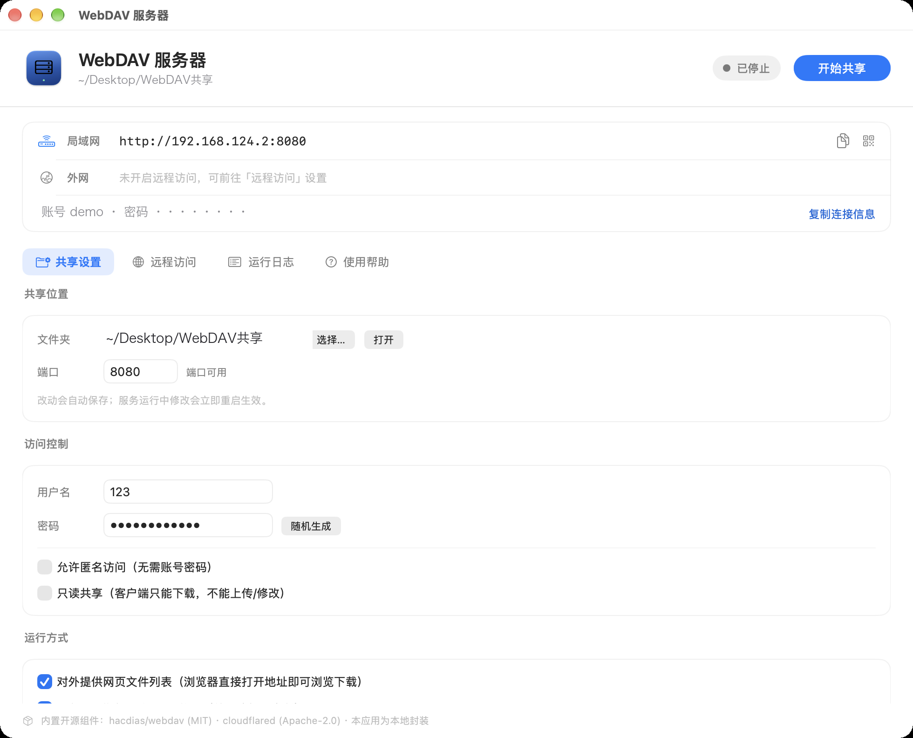
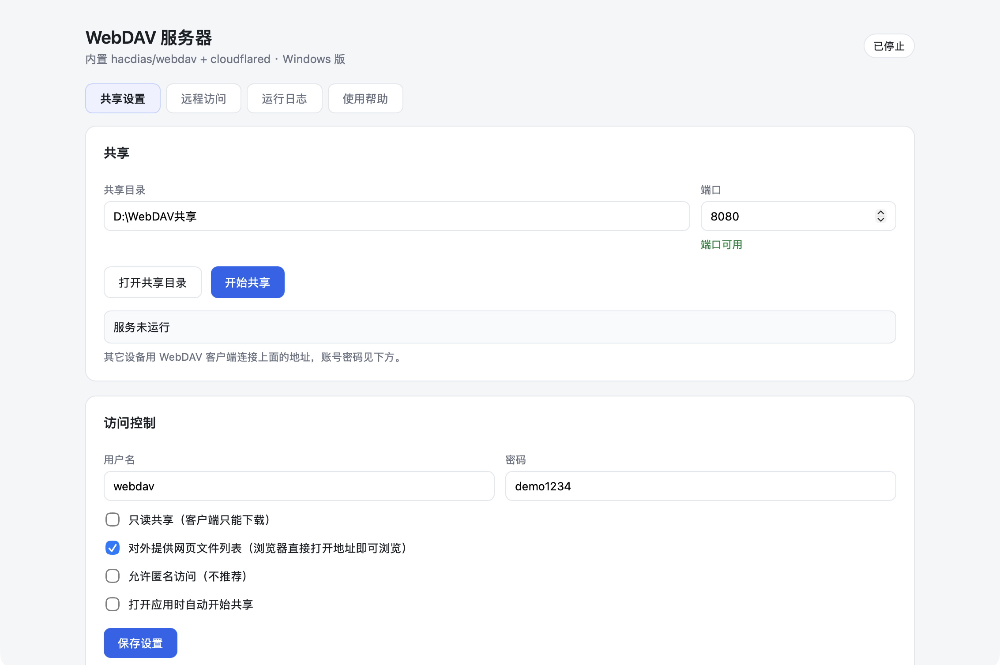

# WebDAV 服务器 · 三平台

一句话：把 Mac / Windows 电脑或安卓手机变成一台标准 WebDAV 服务器，并配一条公网 HTTPS 地址，随时随地读写本机文件。

同一套内核，三个平台三种外壳：macOS 是原生 SwiftUI 菜单栏应用，Windows 是 Go 单文件 + 本地网页控制台，Android 是前台服务 + 单页原生控件。

## 平台与交付物

| 平台 | 外壳 | 界面 | 服务端内核 | 隧道内核 | DDNS |
| --- | --- | --- | --- | --- | --- |
| macOS 14+（arm64） | `macos/`（Swift） | SwiftUI 原生窗口 + 菜单栏 | hacdias/webdav v5.17.3 `darwin-arm64` | cloudflared 2026.10.7 | ✅ |
| Windows 10/11 x64 | `windows/`（Go） | 本地网页控制台，双击自动开浏览器 | 同版本 `windows-amd64` | 同版本 `windows-amd64` | ✅ |
| Android 8+（arm64） | `android/`（Java + Gradle） | 单页原生控件 + 前台服务 | 同版本 `linux-arm64`（打包为 `libwebdav.so`） | 同版本 `linux-arm64` | ❌ |

三条远程访问通道：Cloudflare 快速隧道（免账号，一键生成 `https://xxx.trycloudflare.com`）、自有域名 + 命名隧道（地址固定）、DDNS + 端口映射（家里有公网 IP 直连）。隧道自带 HTTPS。

## 界面

macOS 版：原生 SwiftUI 窗口，菜单栏常驻，地址、二维码、账号密码一屏搞定。



Windows 版：Go 单文件启动后自动开浏览器，本地网页控制台就是全部界面。



Android 版：单页原生控件 + 前台服务，布局与上面两端同构（截图待补）。

## 使用说明

- macOS：[docs/使用说明-macOS.md](docs/使用说明-macOS.md)
- Windows：[docs/使用说明-Windows.md](docs/使用说明-Windows.md)
- Android：[docs/使用说明-Android.md](docs/使用说明-Android.md)
- 三平台功能对照：[docs/三平台总览.md](docs/三平台总览.md) · 功能清单：[docs/功能介绍.md](docs/功能介绍.md)

## 核心功能

- **一键成服务器**：选文件夹、设端口、设账号密码，点「开始共享」即可。标准 WebDAV 协议，访达 / 资源管理器 / iOS 文件 App / Cyberduck / nPlayer 都能直连。
- **完整读写**：PROPFIND、PUT、MKCOL、DELETE、LOCK 全部支持，也可切只读模式。
- **网页文件列表**：浏览器打开地址直接看列表、点开下载。
- **局域网零配置**：同 Wi-Fi 下直接给出 `http://本机IP:端口` 和二维码。
- **内置容错**：QUIC 不通自动回退 HTTP/2；429 限流给出可读提示；端口占用与残留进程自动回收。
- **常驻与自动化**：菜单栏 / 通知栏常驻，运行期间阻止休眠，支持开机自启、打开即共享，密码与 Token 存入系统钥匙串。

## 仓库结构

```
macos/     macOS 版 Swift 源码（./build.sh 打包成 .app）
windows/   Windows 版 Go 源码（GOOS=windows go build）
android/   Android 版源码（Gradle 工程，./gradlew assembleDebug）
docs/      macOS / Windows / Android 使用说明与功能总览
scripts/   拉取上游内核二进制的小脚本
```

## 构建

三个平台都直接打包上游官方二进制，仓库里不存放这些体积较大的可执行文件，首次构建前先拉取：

```bash
./scripts/fetch-binaries.sh macos     # 取 darwin-arm64 的 webdav + cloudflared
./scripts/fetch-binaries.sh windows   # 取 windows-amd64
./scripts/fetch-binaries.sh android   # 取 linux-arm64，落到 app/src/main/jniLibs/arm64-v8a
```

**macOS**

```bash
cd macos && ./build.sh          # 产物：../WebDAV服务器.app，本地 ad-hoc 签名
```

**Windows**

```bash
cd windows && GOOS=windows GOARCH=amd64 go build -o WebDAVServer.exe
```

产物需与 `resources/`（内含 `webdav.exe`、`cloudflared.exe`）放在同一目录。

**Android**

```bash
cd android && ./gradlew assembleDebug   # 需在 local.properties 里配置 sdk.dir
```

`jniLibs/arm64-v8a` 下的 `libwebdav.so`、`libcloudflared.so` 放的是上游 `linux-arm64` 二进制，改名后随 APK 打包。

## 安装包

编译好的 macOS `.dmg`、Windows `.zip`、Android `.apk` 见 [Releases](https://github.com/qyld1219/WebDAV-Server/releases/latest)：

| 平台 | 文件 |
| --- | --- |
| macOS 14+（arm64） | `WebDAV-Server-1.0-macos-arm64.dmg` |
| Windows 10/11 x64 | `WebDAVServer-Windows-x64.zip` |
| Android 8+（arm64） | `WebDAVServer-android-arm64.apk` |

## 致谢

这个项目本身只是「壳」，真正把文件共享出去的能力全来自两位开源作者的项目，在此郑重致谢：

- **[hacdias/webdav](https://github.com/hacdias/webdav)** —— Henrique Dias（[@hacdias](https://github.com/hacdias)）写的 WebDAV 服务端，MIT 许可。三端的服务端内核都是它（v5.17.3），协议实现一行没改。
- **[cloudflared](https://github.com/cloudflare/cloudflared)** —— Cloudflare 官方开源的隧道客户端，Apache-2.0 许可。三端的公网通道都靠它（2026.10.7）。

也感谢 Go、Swift、Gradle 这些工具链的维护者，以及所有把 WebDAV 生态维持得这么好用的开发者。如果这个壳对你有用，请把 star 也分一点给上面这两个上游仓库。

## 开源组件

| 组件 | 版本 | 许可 | 用途 |
| --- | --- | --- | --- |
| [hacdias/webdav](https://github.com/hacdias/webdav) | v5.17.3 | MIT | WebDAV 服务端 |
| [cloudflared](https://github.com/cloudflare/cloudflared) | 2026.10.7 | Apache-2.0 | Cloudflare 隧道 |

三端均直接打包上游官方二进制，未修改其协议实现。相关许可见 `macos/Resources/LICENSE`。

## 注意

- 公网暴露文件务必保留账号密码，只读模式按需开启。
- macOS 版为本地 ad-hoc 签名，首次打开需右键「打开」或在「隐私与安全性」里放行。
- 共享出去的内容请自行评估风险，本项目的作者不对数据泄露或误操作负责。
